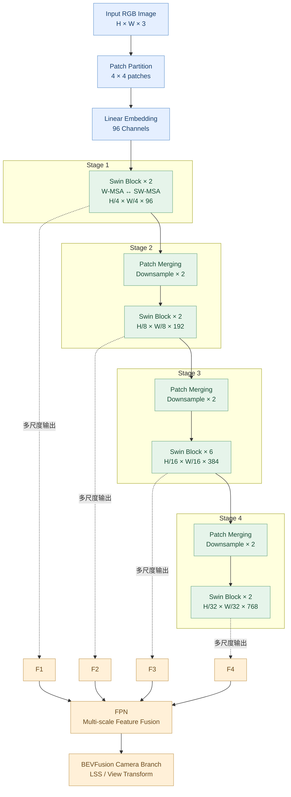
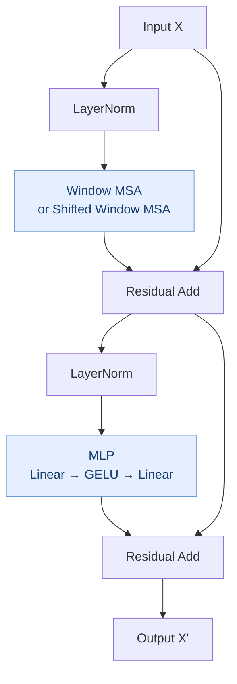

# Swin Transformer 完整架构图

Swin Transformer 是一种分层式 Vision Transformer（视觉 Transformer）。核心创新是：**在局部窗口内计算 Self-Attention，再通过 Shifted Window 让相邻窗口交换信息，同时逐层降低特征图分辨率、增加通道数。**

在 BEVFusion 中，Swin Transformer 是 Camera 分支的图像特征提取 Backbone，后面通常再接 FPN 和 LSS。

## 一、Swin Transformer 整体网络架构

以上是典型 Swin-T（Tiny）结构示意：Embedding Dimension 为 96，四个 Stage 的 Block 数为 `[2, 2, 6, 2]`，通道数依次为 96、192、384、768。具体输出节点及归一化细节以实际实现配置为准。

## 二、一个 Swin Transformer Block 内部是什么？

每个 Block 主要包含 Attention 和 MLP，并通过残差连接传递特征。

数学形式如下。这里的 Attention 可以是 W-MSA，也可以是 SW-MSA，取决于当前 Block：

$$
\\hat{X}=X+\\operatorname{Attention}(\\operatorname{LN}(X))
$$

$$
X'=\\hat{X}+\\operatorname{MLP}(\\operatorname{LN}(\\hat{X}))
$$

其中，`Attention` 在普通窗口 Block 中表示 W-MSA，在移位窗口 Block 中表示 SW-MSA。

这里省略了 Dropout、DropPath 等训练细节。

## 三、W-MSA 与 SW-MSA 的区别

### W-MSA：窗口注意力

将特征图切成互不重叠的窗口，只在每个窗口内部计算 Attention。

### SW-MSA：移位窗口注意力

将窗口分区平移，使原本属于不同窗口的特征能够在下一层交互。

例如，窗口大小为 $7 \\times 7$，每个窗口有 49 个 Token。

普通全局 Attention 的主要计算规模近似为：

$$
O((HW)^2C)
$$

窗口 Attention 则近似为：

$$
O(HW M^2C)
$$

其中 $M=7$ 是窗口边长，$C$ 是通道数。因此，当特征图很大时，窗口注意力可以显著降低计算量。

**注意：移位窗口并不是简单把整个特征图平移一下。** 实现时通常还需要循环移位、Attention Mask 和逆移位，避免不应该相互注意的区域发生错误交互。

## 四、Patch Merging：为什么分辨率越来越低？

Swin Transformer 不同于始终保持相同分辨率的普通 ViT，它会逐阶段下采样。

以 Swin-T 为例：

| 阶段 | 特征图分辨率 | 通道数 | Block 数 | 注意力头数 |
|---|---|---:|---:|---:|
| Stage 1 | $H/4 \\times W/4$ | 96 | 2 | 3 |
| Stage 2 | $H/8 \\times W/8$ | 192 | 2 | 6 |
| Stage 3 | $H/16 \\times W/16$ | 384 | 6 | 12 |
| Stage 4 | $H/32 \\times W/32$ | 768 | 2 | 24 |

Patch Merging 会把相邻的 $2\\times2$ 特征位置组合起来，再经过线性映射，使空间尺寸减半、通道数加倍。

这让网络逐渐从细节特征转向高级语义特征，同时保留多尺度输出供 FPN 使用。

## 五、Swin Transformer 在 BEVFusion 中的位置

Swin Transformer 本身**不负责输出三维车辆位置，也不直接生成 BEV**。它输出的是图像特征。

接下来的 FPN 融合多尺度特征，LSS 再结合深度分布和相机标定，将这些二维特征映射到 BEV 空间。

整个流程可以理解为：

- **Swin Transformer：** 从图像中提取局部纹理和高级语义。
- **FPN：** 融合不同分辨率的图像特征。
- **LSS：** 估计深度分布并进行视角转换。
- **BEVFusion：** 将 Camera BEV 与 LiDAR BEV 融合，供下游检测头使用。

这也解释了为什么在 BEVFusion 中替换 Swin Transformer 时，必须同时关注 FPN 的输入通道、输出尺度和 LSS 的特征接口。
