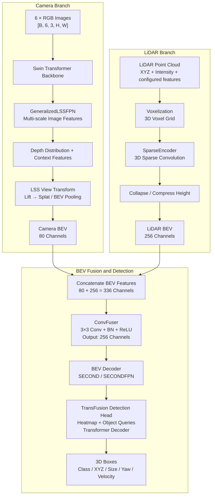
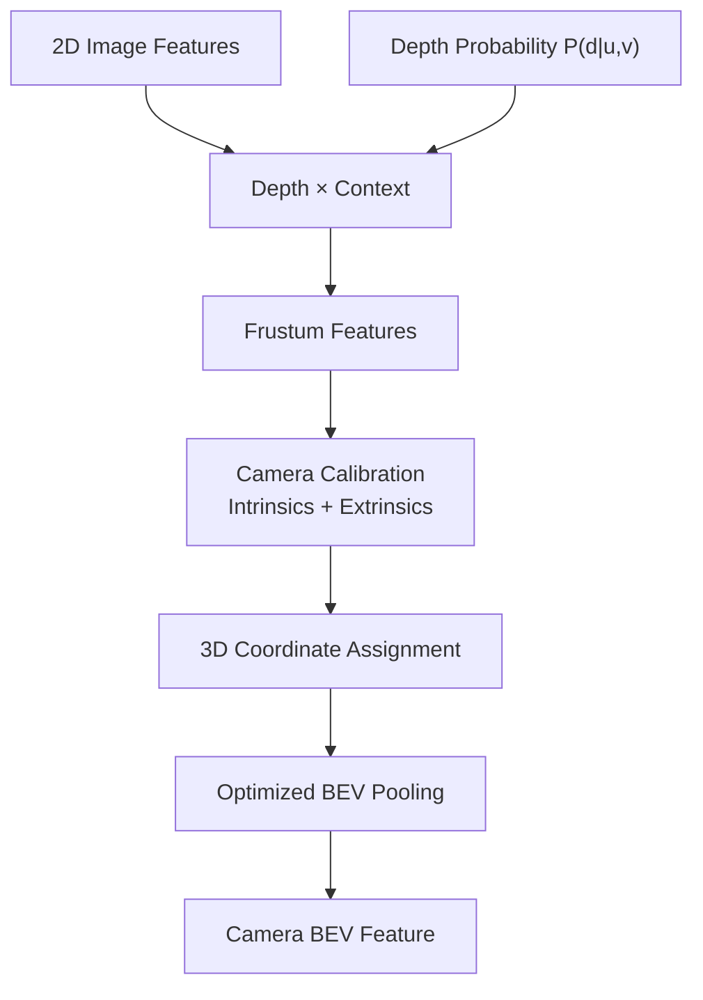
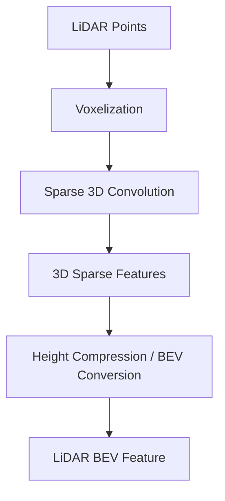
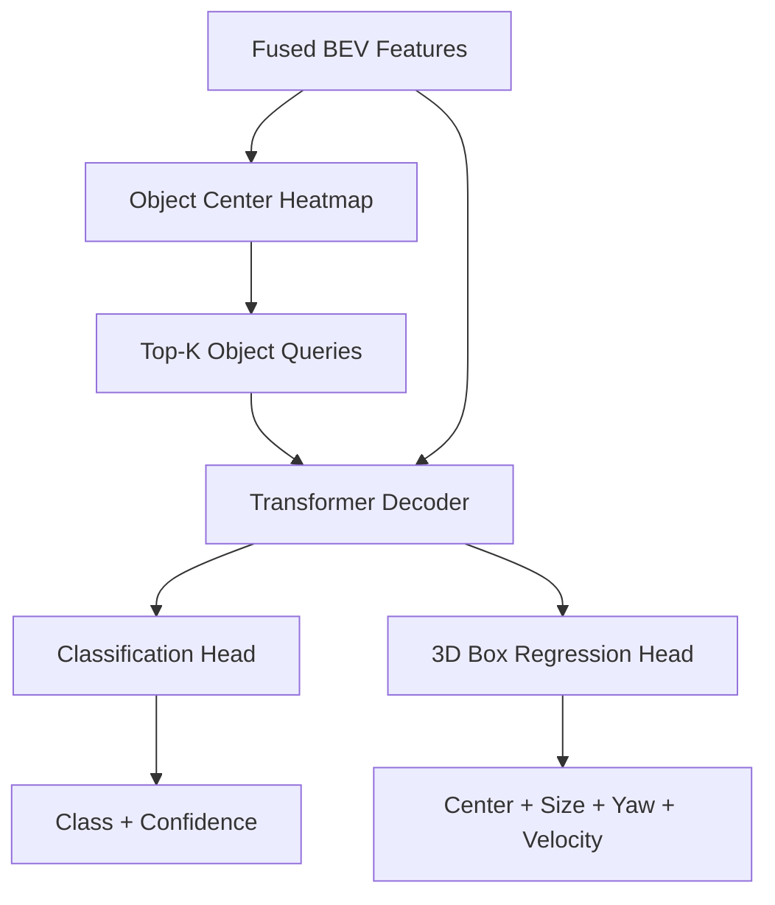

# BEVFusion 完整网络架构图

本文以 **MIT HAN Lab 的 BEVFusion（ICRA 2023）** 为例，参考官方 PyTorch 仓库及 nuScenes `camera+lidar/swint_v0p075/convfuser.yaml` 检测配置，整理其整体架构、核心模块、数据流与主要计算原理。

官方资源：
- GitHub：https://github.com/mit-han-lab/bevfusion
- MIT 项目页：https://hanlab.mit.edu/projects/bevfusion
- Camera + LiDAR 检测配置：https://github.com/mit-han-lab/bevfusion/blob/main/configs/nuscenes/det/transfusion/secfpn/camera%2Blidar/swint_v0p075/convfuser.yaml
- 主模型实现：https://github.com/mit-han-lab/bevfusion/blob/main/mmdet3d/models/fusion_models/bevfusion.py

> 注意：BEVFusion 存在不同论文实现和配置版本。以下具体通道数和模块组合对应 MIT HAN Lab 仓库中的指定 `ConvFuser` + `TransFusionHead` 检测配置，不代表所有名为 BEVFusion 的实现都完全相同。官方 GitHub 仓库目前已归档为只读。官方仓库和项目页均介绍了其统一 BEV 表示与优化 BEV Pooling 的设计。  
> 参考：[官方 GitHub](https://github.com/mit-han-lab/bevfusion)、[MIT 项目页](https://hanlab.mit.edu/projects/bevfusion)。

## 1. 核心架构概览

BEVFusion 的核心流程可以概括为：

- **Camera：** RGB 图像 → Swin Transformer → FPN → LSS View Transform → Camera BEV
- **LiDAR：** 点云 → Voxelization → Sparse 3D CNN → 高度压缩 → LiDAR BEV
- **融合与检测：** Camera BEV + LiDAR BEV → ConvFuser → BEV Encoder → TransFusion 检测头 → 3D Bounding Boxes

## 2. 完整网络架构图



这是按指定官方检测配置整理的结构示意。输入图像的确切分辨率、各层形状及通道数应以实际配置为准。

## 3. 模块清单

| 网络阶段 | 模块 | 输入 → 输出 | 作用 |
|---|---|---|---|
| Camera Encoder | Swin Transformer + FPN | RGB → 多尺度视觉特征 | 提取图像纹理、语义与上下文 |
| Depth Network | LSS 深度预测分支 | 图像特征 → 深度分布与上下文特征 | 为图像特征建立深度假设 |
| View Transform | LSS / BEV Pooling | 透视视锥特征 → Camera BEV | 利用标定将特征映射到自车俯视坐标系 |
| LiDAR Encoder | Voxelization + SparseEncoder | 点云 → 三维稀疏特征 | 提取几何结构 |
| Height Compression | 高度压缩 / BEV 化 | 三维特征 → 二维 BEV 特征 | 将高度维信息整合到 BEV 表示 |
| Fusion | ConvFuser | Camera BEV + LiDAR BEV → 融合 BEV | 在统一空间融合两种模态 |
| BEV Decoder | SECOND / FPN 等配置模块 | 融合 BEV → 高级空间特征 | 进一步提取空间上下文 |
| Detection Head | TransFusionHead | BEV 特征 → 3D 框 | 预测类别、中心、尺寸、朝向和速度 |

## 4. Camera 分支：LSS 是关键

### 4.1 图像特征提取

假设输入六路相机：

$$
I\in\mathbb{R}^{B\times 6\times 3\times H\times W}
$$

经过 Swin Transformer 与 FPN，得到多尺度图像特征：

$$
F_{\mathrm{img}}\in
\mathbb{R}^{B\times N_{\mathrm{cam}}\times C\times H'\times W'}
$$

其中：
- $B$：batch size；
- $N_{\mathrm{cam}}$：相机数量；
- $C$：图像特征通道数；
- $H',W'$：特征图空间尺寸。

### 4.2 深度分布与上下文特征

LSS 为图像特征位置预测深度概率：

$$
P(d\mid u,v)
$$

同时产生用于表达语义内容的 Context Feature：

$$
F(u,v)
$$

两者结合，形成视锥特征：

$$
F_{\mathrm{3D}}(u,v,d)
=
F(u,v)\cdot P(d\mid u,v)
$$

直观上，一个像素的语义特征会按不同深度假设分配到三维视锥中的多个位置。

### 4.3 从 Camera View 转到 BEV

通过相机内参、外参和自车坐标系，把视锥中的特征坐标变换到统一的 BEV 网格，再用 BEV Pooling 汇聚到对应网格。



构造稠密视锥特征的张量规模大致随相机数量、图像特征尺寸、深度分桶数和通道数增长：

$$
O(N_{\mathrm{cam}}\cdot H'\cdot W'\cdot D\cdot C)
$$

这只是对稠密视锥特征规模的近似描述，不等于经过优化后的完整实际推理复杂度。

MIT BEVFusion 的一项重要工程贡献，是优化 BEV Pooling 的实现，减少视角变换阶段的延迟和访存开销。详见[官方项目页](https://hanlab.mit.edu/projects/bevfusion)。

## 5. LiDAR 分支：三维稀疏卷积

LiDAR 已经直接测得三维点的位置，因此不需要像 Camera 一样从图像估计深度。

点云可以写作：

$$
P=\{(x_i,y_i,z_i,r_i,\ldots)\}_{i=1}^{N}
$$

这里的点特征字段取决于数据集和预处理配置。nuScenes 常见输入包括 XYZ、反射强度，以及配置可能使用的其他特征。

### 5.1 Voxelization

根据体素尺寸，把点映射到离散三维体素坐标：

$$
(x,y,z)\rightarrow(v_x,v_y,v_z)
$$

指定配置使用的体素尺寸示例为：

$$
(0.075,\ 0.075,\ 0.2)\ \text{m}
$$

实际点云范围和体素参数以所用配置为准。

### 5.2 Sparse 3D CNN

经过 `SparseEncoder` 等稀疏三维卷积模块，在有点的体素位置上计算特征，避免对整个三维空间执行密集卷积。

### 5.3 高度压缩到 BEV

三维特征经过高度维压缩或对应的空间转换，得到 LiDAR BEV 特征。指定 `ConvFuser` 配置中的 LiDAR BEV 输入通道为 256。



## 6. Fusion 层：主要是 Concat + Conv

在 MIT BEVFusion 的指定 `convfuser.yaml` 配置中，融合模块为：

```yaml
model:
  fuser:
    type: ConvFuser
    in_channels: [80, 256]
    out_channels: 256
```

也就是说，Camera BEV 为 80 通道，LiDAR BEV 为 256 通道，拼接后为 336 通道，再经卷积融合到 256 通道。

$$
F_{\mathrm{concat}}
=
\mathrm{Concat}
(F_{\mathrm{camera}},F_{\mathrm{lidar}})
$$

$$
F_{\mathrm{fused}}
=
\mathrm{Conv}_{3\times3}
(F_{\mathrm{concat}})
$$

实际 ConvFuser 还包含配置中的归一化与激活操作（例如 BatchNorm、ReLU）。

```python
# 说明数据流的伪代码，并非原仓库逐字源码
camera_bev = camera_encoder(images)
lidar_bev = lidar_encoder(points)

fused = torch.cat([camera_bev, lidar_bev], dim=1)
fused = conv3x3_bn_relu(fused)

bev_features = bev_decoder(fused)
boxes = detection_head(bev_features)
```

**因此，在这个具体配置中，BEVFusion 的 Fusion 层并不是一个复杂的跨模态 Transformer。** 其关键是先把两种模态对齐到统一 BEV 空间，再进行轻量的特征融合。

## 7. TransFusion Head：从 BEV 特征预测三维框

融合后的 BEV 特征进入 BEV Decoder，再交给 `TransFusionHead`。

其主要流程为：



检测头先通过热力图等机制生成候选对象 Query，再利用 Transformer Decoder 与 BEV 特征交互，细化目标表征并回归三维框。

一种常见的三维框表示为：

$$
b=(x,y,z,w,l,h,\theta,v_x,v_y)
$$

具体回归字段由数据集、检测头配置和实现决定，输出还包括类别与置信度。

源码入口：[TransFusionHead](https://github.com/mit-han-lab/bevfusion/blob/main/mmdet3d/models/heads/bbox/transfusion.py)。

## 8. BEVFusion 与 BEVFormer 的主要区别

| 维度 | BEVFusion（MIT 版本） | BEVFormer 原版 |
|---|---|---|
| Camera → BEV | LSS 深度分布、几何投影、BEV Pooling | Spatial Cross-Attention |
| LiDAR | 独立的几何特征分支 | 原版是纯视觉模型 |
| 多模态融合 | 统一 BEV 后融合 | 原版没有 Camera + LiDAR 融合 |
| 时序融合 | MIT 原版指定配置通常不包含显式 Temporal Attention | Temporal Self-Attention 是核心模块 |
| 主要优势 | 利用 LiDAR 几何提高三维感知精度 | 通过 Transformer 从多视角图像学习 BEV，并融合历史 BEV |

因此，如果要为 BEVFusion 增加时序信息，可以把历史 BEV 对齐到当前自车坐标系后，再与当前 BEV 融合：

$$
F_t^{\mathrm{temporal}}
=
\mathrm{TemporalFusion}
\left(
F_t^{\mathrm{BEV}},
\operatorname{Warp}(F_{t-1}^{\mathrm{BEV}})
\right)
$$

这是一种通用的时序融合示意，不是 MIT 原版 BEVFusion 的内置模块。需要另外验证动态物体残影、时间对齐和推理延迟。

## 9. 官方代码入口

- [MIT BEVFusion 完整源码](https://github.com/mit-han-lab/bevfusion)
- [主模型 BEVFusion / Forward](https://github.com/mit-han-lab/bevfusion/blob/main/mmdet3d/models/fusion_models/bevfusion.py)
- [Camera + LiDAR ConvFuser 配置](https://github.com/mit-han-lab/bevfusion/blob/main/configs/nuscenes/det/transfusion/secfpn/camera%2Blidar/swint_v0p075/convfuser.yaml)
- [MIT 官方论文与项目页面](https://hanlab.mit.edu/projects/bevfusion)

## 10. 总结

BEVFusion 的核心不是 Fusion 层本身有多复杂，而是：

1. **Camera-to-BEV 视角变换：** 把稠密图像语义映射到统一空间；
2. **LiDAR 几何编码：** 利用真实三维测量建立几何特征；
3. **统一 BEV 对齐：** 让 Camera 与 LiDAR 在相同空间位置进行融合；
4. **任务专用 Head：** 在融合特征上执行 3D 检测或 BEV 地图分割。

对于后续研究，XYZRGB + DINOv3、4D Radar Doppler 和时序融合，都可以围绕 Camera Encoder、LiDAR/Radar Encoder、Fusion BEV 以及下游任务头进行实验，而不一定要推翻整个系统。
