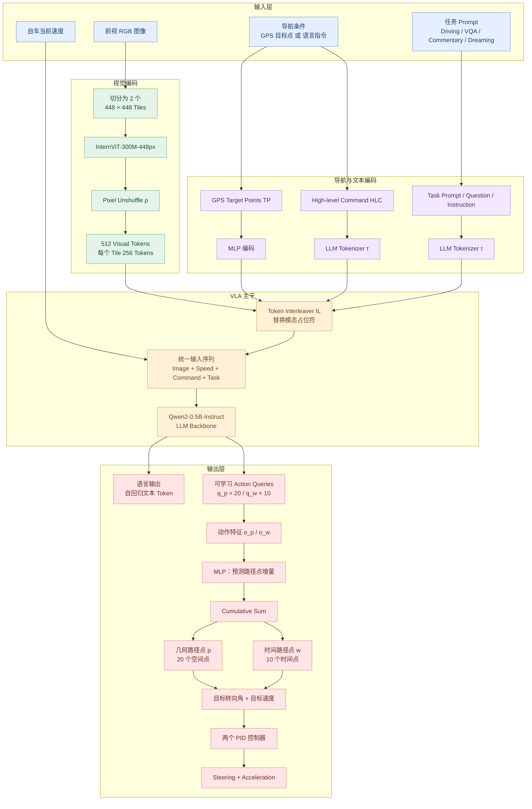
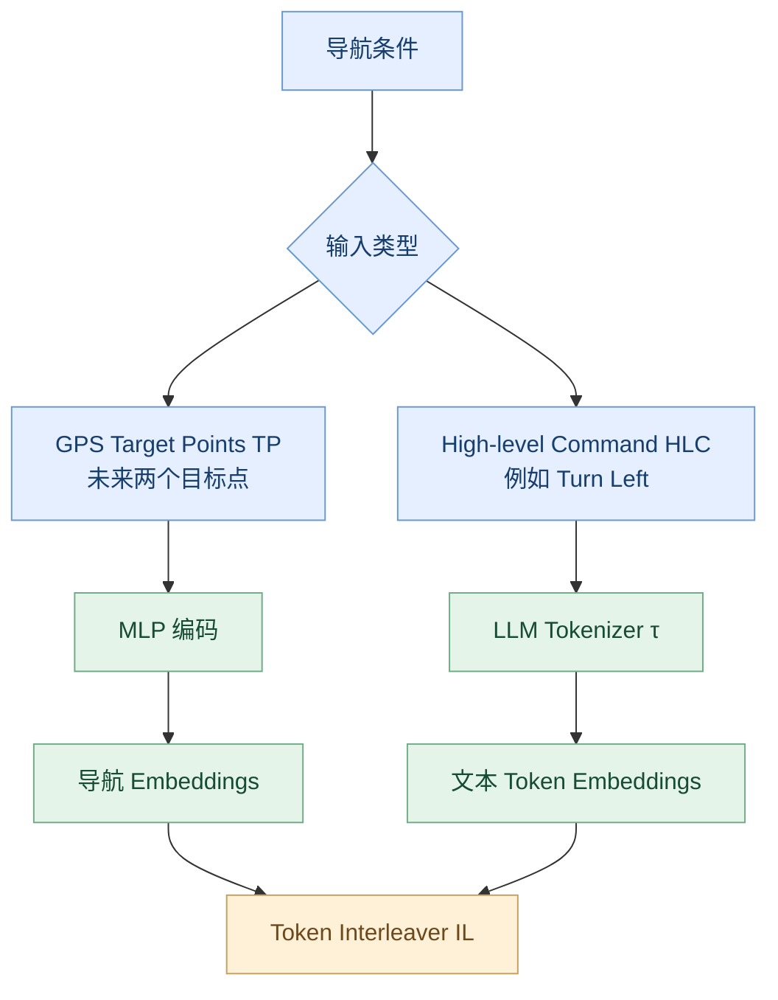
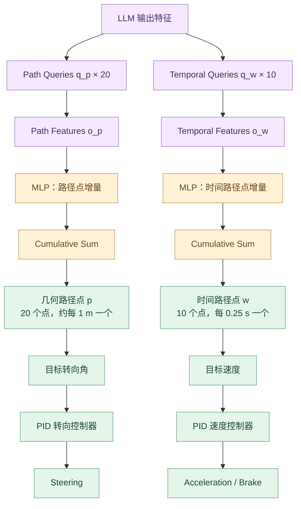
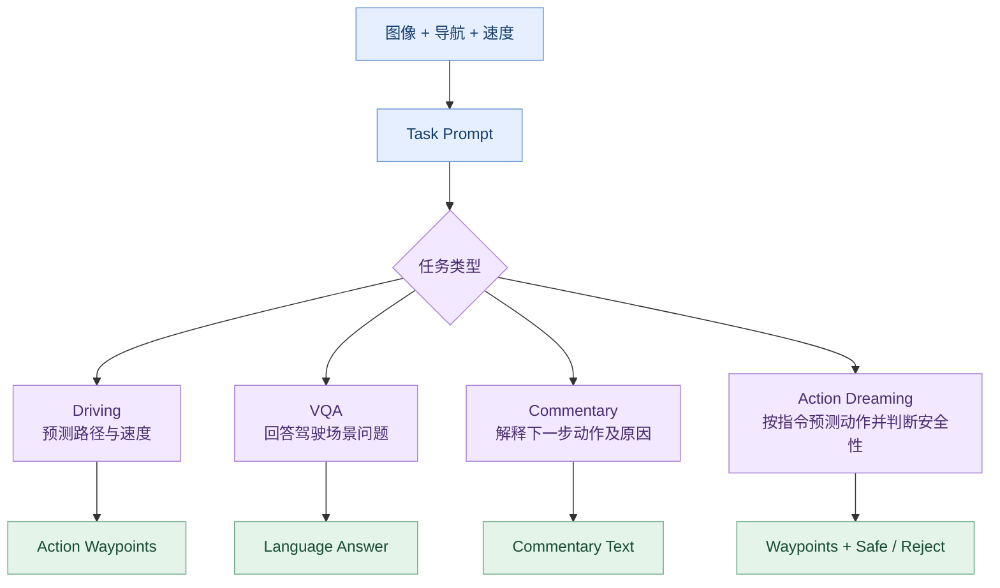

# SimLingo 模型架构图（CSDN 兼容版）

> 论文：*SimLingo: Vision-Only Closed-Loop Autonomous Driving with Language-Action Alignment*（CVPR 2025 Highlight）  
> 官方代码：https://github.com/RenzKa/simlingo  
> 论文：https://arxiv.org/abs/2503.09594  
> 项目主页：https://www.katrinrenz.de/simlingo/

本文根据论文和官方仓库整理。流程图采用彩色 Mermaid 代码，公式使用 Markdown 常见的 `$...$` 与 `$$...$$` 格式。

## 一、SimLingo 整体架构

SimLingo 是一个 Camera-only 的 Vision-Language-Action（VLA）驾驶模型。它将视觉、导航条件、自车速度和任务提示输入统一的 VLM/LLM 主干，同时预测语言输出和驾驶动作。

核心组成：
- 视觉编码器：InternViT-300M-448px。
- 语言模型：Qwen2-0.5B-Instruct；二者组成 InternVL2-1B 基础架构。
- 导航输入：未来两个 GPS 目标点，或高层自然语言指令。
- 输出：语言 Token、几何路径点、时间路径点；最后由 PID 控制器生成转向与加速度控制量。

## 二、视觉输入编码

论文将输入图像切分为 $N_I=2$ 个 $448\\times448$ 图像块，分别通过 InternViT 编码，再使用 Pixel Unshuffle（$\rho$）减少送入 LLM 的视觉 Token 数量。每个 Tile 对应 256 个视觉 Token，总计 512 个。

## 三、导航条件编码

自车速度以文本形式加入 Prompt，例如 `Current speed: 5.2 m/s`。Task Prompt 指明当前执行驾驶、VQA、Commentary 或 Action Dreaming。

Token Interleaver（IL）把视觉、导航与文本 Embeddings 填入 Prompt 中对应的占位符，组成统一的 LLM 输入序列。

## 四、动作输出：两种 Waypoints

SimLingo 不让 LLM 自回归地逐个生成所有动作坐标，而是使用可学习的 Action Query，一次前向计算预测两组路径点。

几何路径点：

$$
\\mathbf{p}\\in\\mathbb{R}^{N_p\\times2},\\qquad N_p=20
$$

表达车辆未来沿道路行驶的空间位置，每个点约间隔 1 米，主要用于描述车辆应走的路径与转向。

时间路径点：

$$
\\mathbf{w}\\in\\mathbb{R}^{N_w\\times2},\\qquad N_w=10
$$

表达车辆在未来特定时刻的位置，每个点间隔 0.25 秒。由时间路径点估计目标速度。

网络先用 MLP 预测相邻路径点的增量，再通过累积求和恢复最终坐标：

$$
\\mathbf{p}_i=\\sum_{j=1}^{i}\\Delta\\mathbf{p}_j
$$

$$
\\mathbf{w}_i=\\sum_{j=1}^{i}\\Delta\\mathbf{w}_j
$$

几何路径用于计算目标转向角，时间路径用于计算目标速度，再通过两个 PID 控制器生成转向与加速度控制量。

## 五、语言任务与 Action Dreaming

四类任务：
1. **Driving：** 预测驾驶路径点与速度。
2. **VQA：** 回答关于当前驾驶场景的问题。
3. **Commentary：** 用自然语言解释下一步应该怎么开、为什么这样开。
4. **Action Dreaming：** 给定加速、减速、变道或面向特定物体的指令，预测对应动作；对不安全指令学习拒绝执行。

论文最终推理默认启用 Commentary：先生成动作及原因的语言解释，再在生成的 Commentary 条件下预测动作。这是 Chain-of-Thought 风格的流程，但文字解释本身并不能保证驾驶安全。

## 六、训练目标与损失函数

语言采用自回归 Token 预测，使用交叉熵损失：

$$
L_{\\mathrm{lang}}=-\\sum_t\\log P(y_t\\mid y_{<t},x)
$$

路径点和时间路径点使用 Smooth L1 Loss：

$$
L_{\\mathrm{action}}=
\\lambda_p L_{\\mathrm{SmoothL1}}(\\hat{\\mathbf{p}},\\mathbf{p})
+\\lambda_w L_{\\mathrm{SmoothL1}}(\\hat{\\mathbf{w}},\\mathbf{w})
$$

整体训练目标可简化表示为：

$$
L_{\\mathrm{total}}=L_{\\mathrm{lang}}+L_{\\mathrm{action}}
$$

以上为对论文训练目标的简化表达；具体任务混合比例和损失权重应以论文与代码配置为准。

## 七、SimLingo 与 BEVFusion 的区别

| 对比项 | BEVFusion | SimLingo |
|---|---|---|
| 输入 | Camera + LiDAR | Camera + 导航 + 速度 + Prompt |
| 中间表示 | Camera / LiDAR BEV 特征 | VLM 的视觉与语言 Token |
| 主要输出 | 3D 检测框、可选地图任务 | 语言回答、路径点与速度路径点 |
| 主要目标 | 感知环境 | 直接预测驾驶动作，并支持语言交互 |
| 是否依赖 LiDAR | 标准融合配置需要 | 不需要 |
| 控制输出 | 需要下游规划与控制 | Waypoints 经 PID 转为转向与加速度 |

SimLingo 的特点不是构建稠密 BEV，也不是显式输出完整三维世界模型，而是把视觉理解、导航条件、语言任务与动作预测统一到一个 VLA 框架中。

## 八、官方资源

- [SimLingo 官方 GitHub](https://github.com/RenzKa/simlingo)
- [CVPR 2025 论文](https://arxiv.org/abs/2503.09594)
- [项目主页](https://www.katrinrenz.de/simlingo/)
- [官方数据集](https://huggingface.co/datasets/RenzKa/simlingo)
- [模型权重](https://huggingface.co/RenzKa/simlingo)

**总结：** SimLingo 的关键设计是使用视觉语言模型统一处理图像、导航和语言提示，再通过专门的 Action Queries 输出几何路径点与时间路径点。它是一种端到端 VLA 驾驶模型，但并不是以 BEV 或显式三维世界重建为核心的架构。
